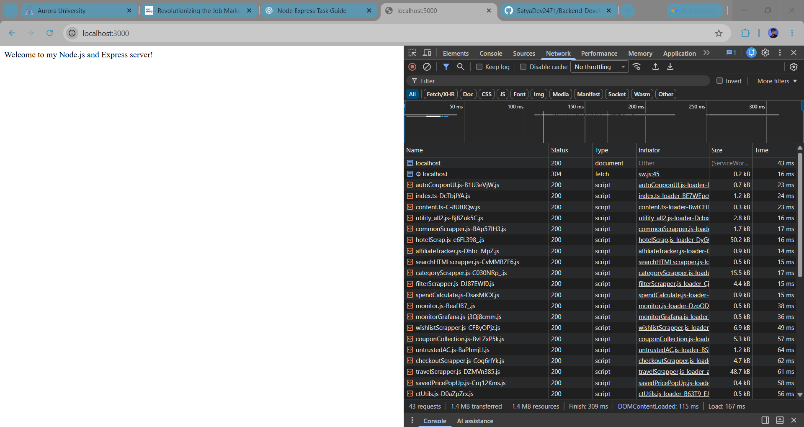
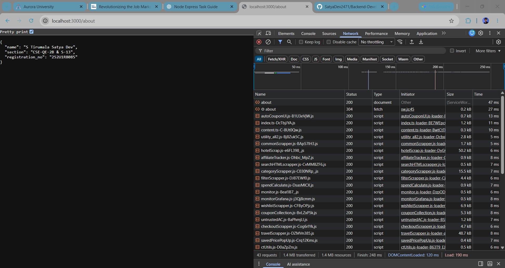
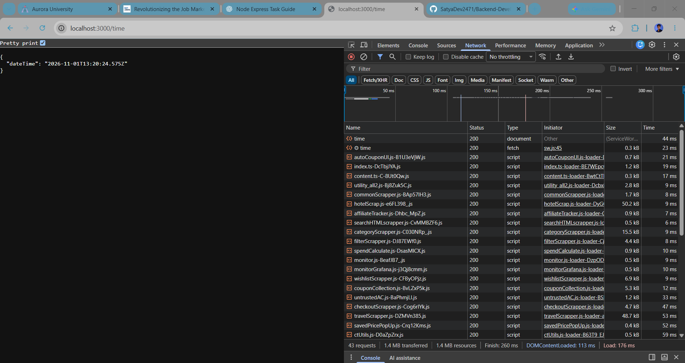
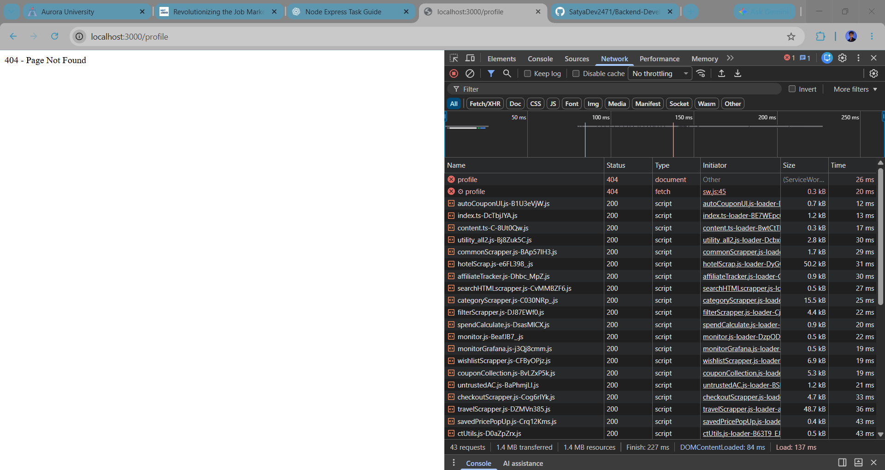

# Lab 1: Node.js and Express Server

## 1. Student Details

- **Name:** SANGITHA TIRUMALA SATYA DEV
- **Registration Number:** 252U1R8085
- **Class:** CSE-QE-2B

## 2. Live Deployment 

**Live URL:** https://bdf-lab-01-i60l.onrender.com

**Deployment Platform:** Render

**Status:** Successfully Deployed

## 3. Objective

The objective of this lab is to understand the
fundamentals of Node.js and Express.js by creating
a basic web server.

This lab demonstrates how to:
- Initialize a Node.js project.
- Install and manage packages using npm.
- Create an HTTP server using the built-in HTTP module.
- Build a web server using Express.js.
- Implement HTTP GET routes.
- Send text and JSON responses.
- Handle unknown routes using HTTP 404 status codes.
- Test API endpoints and verify HTTP status codes.

## 4. Introduction to Node.js

Node.js is a JavaScript runtime environment that
allows JavaScript code to execute outside the browser.

It is commonly used for backend development,
server-side programming and building APIs.

### Key Features of Node.js

- JavaScript execution outside the browser.
- Asynchronous and event-driven architecture.
- Non-blocking I/O operations.
- Built-in modules such as HTTP, FS and Path.
- npm support for package management.

## 5. Introduction to Express.js

Express.js is a lightweight web framework built
on top of Node.js.

It simplifies backend development by providing
features such as routing, middleware and request
and response handling.

### Advantages of Express.js

- Easy server creation.
- Simple routing mechanism.
- Middleware support.
- HTTP request and response handling.
- Suitable for building REST APIs.

## 6. Project Setup

### Step 1: Create Project Folder

Create a folder named `BDF_Lab-01` and open it in VS Code.

### Step 2: Initialize Node.js Project

Execute:

```bash
npm init -y
```

This command creates a `package.json` file
containing project information, dependencies
and scripts.

### Step 3: Install Express.js

Execute:

```bash
npm install express
```

This installs Express.js and its required
dependencies inside the `node_modules` folder.

### Important Project Files

| File | Purpose |
|------|---------|
| package.json | Stores project details and dependencies |
| package-lock.json | Locks dependency versions |
| node_modules | Contains installed packages |
| app.js | Contains the Express server |
| server.js | Contains the Node.js HTTP server |
| README.md | Project documentation |
| .gitignore | Specifies files Git should ignore |

## 7. Implementation

### Task 1: Creating a Node.js HTTP Server

The built-in HTTP module allows us to create
a server without installing additional frameworks.

We use `http.createServer()` to create a server
that receives requests and sends responses.

**Implementation:**

See `server.js`.

**Explanation:**

- `require('http')` imports the HTTP module.
- `http.createServer()` creates the server.
- `request` represents incoming client requests.
- `response` is used to send data to the client.
- `response.writeHead()` sets the HTTP status code
  and response headers.
- `response.end()` sends the response.
- `server.listen(3000)` starts the server on port 3000.

### Task 2: Creating an Express Server

Express simplifies server creation compared
to the built-in HTTP module.

**Implementation:**

See `app.js`.

**Explanation:**

- `require('express')` imports Express.
- `express()` creates an Express application.
- `app.listen(3000)` starts the server.
- The server waits for incoming HTTP requests.

### Task 3: Implementing GET Routes

Routing determines how a server responds to
requests made to different URLs.

#### A. Home Route

**Method:** GET

**Path:** `/`

This route returns a welcome message when
the user visits the home endpoint.

The `response.send()` method sends text
back to the client.

#### B. About Route

**Method:** GET

**Path:** `/about`

This route returns information about the developer
in JSON format.

The `response.json()` method sends a JSON response.

Example:

```json
{
    "name": "S Tirumala Satya Dev",
    "section": "CSE-QE-2B & S-13",
    "registration_no": "252U1R8085",
  }
```

#### C. Time Route

**Method:** GET

**Path:** `/time`

This route returns the current date and time.

The JavaScript `new Date()` constructor retrieves
the current system date and time.

### Task 4: Handling Unknown Routes

A 404 status code indicates that the requested
resource could not be found.

Express provides `app.use()` to register middleware.

By placing the 404 handler after all valid routes,
we ensure that unmatched requests receive a
404 response.

Expected response:

```text
404 - Page Not Found
```

## 8. API Endpoint Documentation

| HTTP Method | Endpoint | Description | Status |
|-------------|----------|-------------|--------|
| GET | `/` | Returns welcome message | 200 |
| GET | `/about` | Returns name and section in JSON | 200 |
| GET | `/time` | Returns current date and time | 200 |
| GET | Unknown path | Returns not found message | 404 |

## 9. How to Run the Project

### Prerequisites

- Node.js installed.
- npm installed.
- VS Code or any code editor.

### Installation

Clone the repository:

```bash
git clone https://github.com/SatyaDev2471/Backend-Development-Fundamentals
```

Navigate to the lab folder:

```bash
cd BDF-Lab-01
```

Install dependencies:

```bash
npm install
```

Start the application:

```bash
npm start
```

Open the browser:

```text
http://localhost:3000
```

## 10. Testing and Screenshots

All endpoints were tested using a web browser.

### Home Endpoint



### About Endpoint



### Time Endpoint



### 404 Error Handling



## 11. HTTP Status Codes

HTTP status codes indicate the result of
a client's request.

| Status Code | Meaning |
|-------------|---------|
| 200 | OK - Request successful |
| 404 | Not Found - Requested resource unavailable |

## 12. Difference Between Node.js HTTP and Express.js

| Node.js HTTP | Express.js |
|--------------|------------|
| Built-in module | External framework |
| Manual request handling | Simplified request handling |
| Uses `createServer()` | Uses `express()` |
| More manual routing | Easy routing using `app.get()` |
| Uses `response.end()` | Uses `response.send()` |

## 13. Problems Faced and Solutions

| Problem | Solution |
|---------|----------|
| Express module not found | Installed Express using npm |
| Port already in use | Stopped the existing server |
| Unknown endpoint returning incorrect response | Added a 404 middleware after all routes |
| Server not starting | Checked the code and port configuration |

## 14. Learning Outcomes

After completing this lab, I understood:

1. How to initialize a Node.js project.
2. How npm manages project dependencies.
3. How to create a basic HTTP server.
4. How Express simplifies server development.
5. How to implement GET routes.
6. How to send text and JSON responses.
7. How to handle unknown endpoints.
8. How to test HTTP status codes.

## 15. Conclusion

This lab provided practical experience with
Node.js and Express.js fundamentals.

I learned how to initialize a backend project,
install dependencies, create HTTP servers and
implement different GET endpoints.

I also understood request-response handling,
routing and HTTP status codes.

Overall, this lab established a foundation
for developing backend applications and REST APIs.
