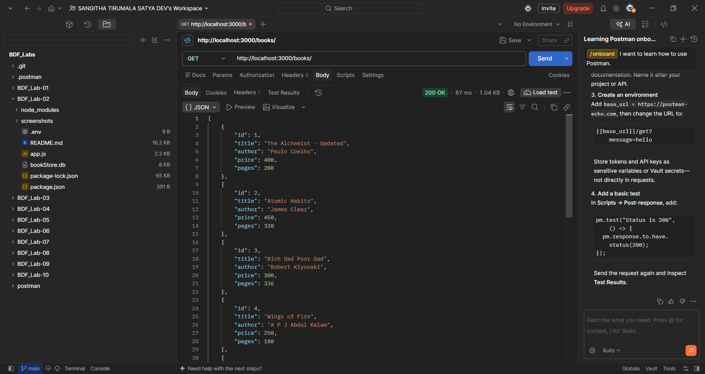
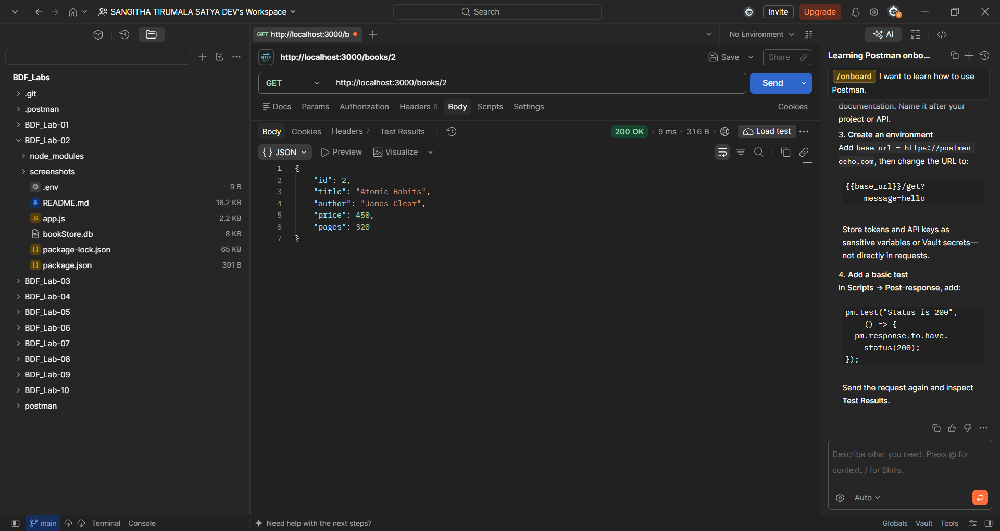
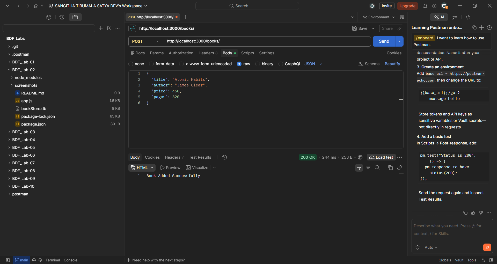
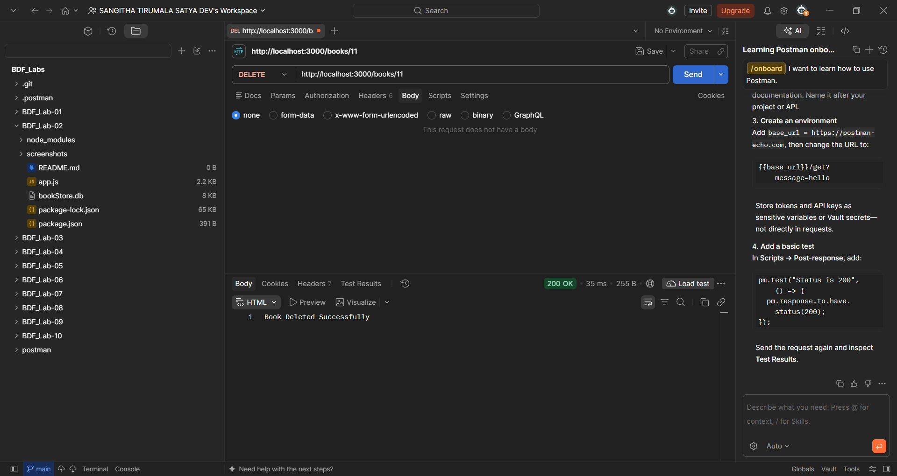
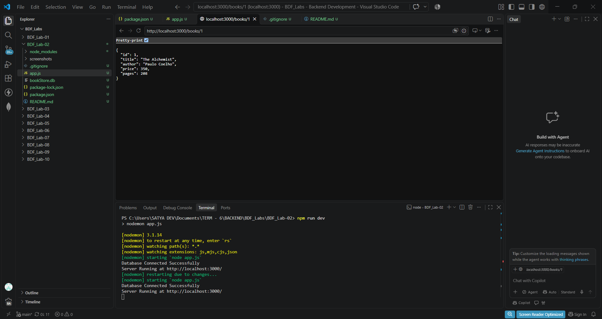
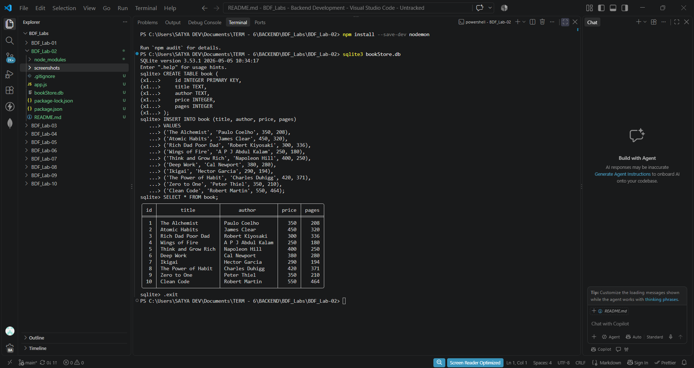

# Lab 2: SQLite Database and CRUD Operations

## 1. Student Details

- **Name:** SANGITHA TIRUMALA SATYA DEV
- **Registration Number:** 252U1R8085
- **Class:** CSE-QE-2B

## 2. Live Deployment

- **Live URL:** https://bdf-lab-02-0svi.onrender.com/
- **Deployment Platform:** Render
- **Status:** Successfully Deployed
- **Database:** SQLite
- **Hosting Type:** Render Web Service

### Live API Endpoints

| Method | Endpoint | Description |
|---|---|---|
| GET | `/books/` | Retrieve all books |
| GET | `/books/:bookId/` | Retrieve a specific book |
| POST | `/books/` | Add a new book |
| PUT | `/books/:bookId/` | Update an existing book |
| DELETE | `/books/:bookId/` | Delete a book |

## 3. Objective

The objective of this lab is to understand how to connect an Express.js server to an SQLite relational database and perform CRUD (Create, Read, Update, Delete) operations through HTTP API endpoints.

This lab demonstrates how to:

- Install and configure SQLite database packages.
- Create and connect to an SQLite database.
- Create database tables and insert records.
- Connect an Express.js application to SQLite.
- Perform database operations using asynchronous functions.
- Implement GET, POST, PUT and DELETE API endpoints.
- Use parameterized SQL queries to prevent SQL injection.
- Test API endpoints using Postman.
- Verify database changes using SQLite CLI.

## 4. Introduction to SQLite

SQLite is a lightweight, serverless relational database management system (RDBMS).

It stores the entire database in a single file and does not require a separate database server.

SQLite is useful for small applications, development environments, educational projects and embedded systems.

### Key Features of SQLite

- Lightweight and easy to configure.
- Serverless database architecture.
- Stores data in a single database file.
- Supports SQL queries.
- Supports relational database operations.
- Does not require a separate database server.

## 5. Introduction to CRUD Operations

CRUD represents the four fundamental operations performed on database records.

| Operation | SQL Command | HTTP Method | Purpose |
|---|---|---|---|
| Create | INSERT | POST | Add a new record |
| Read | SELECT | GET | Retrieve records |
| Update | UPDATE | PUT | Modify an existing record |
| Delete | DELETE | DELETE | Remove a record |

These operations allow applications to manage data through APIs.

## 6. Project Setup

### Step 1: Create Project Folder

Create a folder named `BDF_Lab-02` inside the main `BDF_Labs` directory.

Open the folder in VS Code.

### Step 2: Initialize Node.js Project

Execute:

```bash
npm init -y
```

This command creates the `package.json` file containing project information, dependencies and scripts.

### Step 3: Install Required Packages

Install Express, SQLite and SQLite3:

```bash
npm install express sqlite sqlite3
```

Install Nodemon as a development dependency:

```bash
npm install --save-dev nodemon
```

### Step 4: Configure package.json

Add the following scripts:

```json
"scripts": {
  "start": "node app.js",
  "dev": "nodemon app.js"
}
```

- `npm start` runs the application normally.
- `npm run dev` runs the application using Nodemon.
- Nodemon automatically restarts the server when code changes are saved.

### Important Project Files

| File | Purpose |
|---|---|
| app.js | Contains the Express server and API routes |
| bookStore.db | SQLite database file |
| package.json | Stores project information and dependencies |
| package-lock.json | Locks dependency versions |
| node_modules | Contains installed packages |
| README.md | Project documentation |
| .gitignore | Specifies files Git should ignore |
| screenshots/ | Stores API testing screenshots |

## 7. Database Design and Implementation

### Task 1: Creating the SQLite Database

A database named `bookStore.db` was created for storing book information.

The database contains a table named `book`.

### Table Structure

```sql
CREATE TABLE book (
    id INTEGER PRIMARY KEY,
    title TEXT,
    author TEXT,
    price INTEGER,
    pages INTEGER
);
```

### Explanation of Columns

| Column | Data Type | Description |
|---|---|---|
| id | INTEGER | Unique identifier for each book |
| title | TEXT | Name of the book |
| author | TEXT | Author of the book |
| price | INTEGER | Price of the book |
| pages | INTEGER | Number of pages |

The `id` column is the primary key, which uniquely identifies each book record.

### Task 2: Inserting Initial Records

Sample book records were inserted into the database using SQLite CLI.

Example:

```sql
INSERT INTO book (title, author, price, pages)
VALUES ('The Alchemist', 'Paulo Coelho', 350, 208);
```

To view the records:

```sql
SELECT * FROM book;
```

To count the records:

```sql
SELECT COUNT(*) FROM book;
```

## 8. Connecting SQLite with Express.js

The Express application connects to SQLite using the `sqlite` and `sqlite3` packages.

### Required Imports

```javascript
const express = require('express')
const path = require('path')
const {open} = require('sqlite')
const sqlite3 = require('sqlite3')
```

### Explanation

- `express` is used to create the backend application.
- `path` helps construct the database file path.
- `open` is used to establish the SQLite database connection.
- `sqlite3` provides the SQLite database driver.

### Creating the Express Application

```javascript
const app = express()
app.use(express.json())
```

- `express()` creates an Express application.
- `express.json()` is middleware that parses incoming JSON request bodies.

### Database Path

```javascript
const dbPath = path.join(__dirname, 'bookStore.db')

let db = null
```

- `__dirname` represents the current directory.
- `path.join()` constructs the database file path.
- `db` stores the database connection after initialization.

### Database Initialization

An asynchronous function named `initializeDBAndServer()` is used to connect to the database and start the server.

```javascript
const initializeDBAndServer = async () => {
  try {
    db = await open({
      filename: dbPath,
      driver: sqlite3.Database,
    })

    app.listen(3000, () => {
      console.log('Server Running at http://localhost:3000/')
    })
  } catch (error) {
    console.log(`DB Error: ${error.message}`)
    process.exit(1)
  }
}

initializeDBAndServer()
```

### Explanation

- `async` allows the function to use asynchronous operations.
- `await open()` waits until the database connection is established.
- `filename` specifies the database file.
- `driver` specifies the SQLite database driver.
- `app.listen()` starts the Express server only after the database connection succeeds.
- `try...catch` handles database connection errors.
- `process.exit(1)` terminates the application if initialization fails.

## 9. Implementation of CRUD API Endpoints

Five API endpoints were implemented to perform CRUD operations on the `book` table.

### Task 1: GET All Books

**HTTP Method:** GET

**Endpoint:** `/books/`

**Purpose:** Retrieve all books stored in the database.

**SQL Query:**

```sql
SELECT * FROM book;
```

**Implementation:**

```javascript
app.get('/books/', async (request, response) => {
  const getBooksQuery = `
    SELECT *
    FROM book;
  `

  const books = await db.all(getBooksQuery)
  response.send(books)
})
```

**Explanation:**

- `app.get()` defines a GET route.
- `db.all()` retrieves all matching records.
- `await` waits for the database operation.
- `response.send()` sends the retrieved book records to the client.

### Task 2: GET a Single Book

**HTTP Method:** GET

**Endpoint:** `/books/:bookId/`

**Purpose:** Retrieve a specific book using its ID.

**Example:** `/books/1/`

**SQL Query:**

```sql
SELECT *
FROM book
WHERE id = ?;
```

**Implementation:**

```javascript
app.get('/books/:bookId/', async (request, response) => {
  const {bookId} = request.params

  const getBookQuery = `
    SELECT *
    FROM book
    WHERE id = ?;
  `

  const book = await db.get(getBookQuery, [bookId])
  response.send(book)
})
```

**Explanation:**

- `:bookId` is a route parameter.
- `request.params` extracts the book ID from the URL.
- `db.get()` retrieves one matching record.
- The `?` placeholder is replaced by the supplied book ID.

### Task 3: POST a New Book

**HTTP Method:** POST

**Endpoint:** `/books/`

**Purpose:** Insert a new book into the database.

**SQL Query:**

```sql
INSERT INTO book (title, author, price, pages)
VALUES (?, ?, ?, ?);
```

**Implementation:**

```javascript
app.post('/books/', async (request, response) => {
  const {title, author, price, pages} = request.body

  const addBookQuery = `
    INSERT INTO book (title, author, price, pages)
    VALUES (?, ?, ?, ?);
  `

  await db.run(addBookQuery, [title, author, price, pages])

  response.send('Book Added Successfully')
})
```

**Explanation:**

- `app.post()` defines a POST route.
- `request.body` contains the JSON data sent by the client.
- The book properties are extracted using destructuring.
- `INSERT INTO` adds a new record.
- `db.run()` executes the insertion query.
- The success message is returned to the client.

**Example JSON Request:**

```json
{
  "title": "Atomic Habits",
  "author": "James Clear",
  "price": 450,
  "pages": 320
}
```

### Task 4: PUT to Update a Book

**HTTP Method:** PUT

**Endpoint:** `/books/:bookId/`

**Purpose:** Update the details of an existing book using its ID.

**SQL Query:**

```sql
UPDATE book
SET
    title = ?,
    author = ?,
    price = ?,
    pages = ?
WHERE id = ?;
```

**Implementation:**

```javascript
app.put('/books/:bookId/', async (request, response) => {
  const {bookId} = request.params
  const {title, author, price, pages} = request.body

  const updateBookQuery = `
    UPDATE book
    SET
      title = ?,
      author = ?,
      price = ?,
      pages = ?
    WHERE id = ?;
  `

  await db.run(updateBookQuery, [
    title,
    author,
    price,
    pages,
    bookId,
  ])

  response.send('Book Updated Successfully')
})
```

**Explanation:**

- `app.put()` defines a PUT route.
- `request.params` retrieves the book ID.
- `request.body` retrieves the updated book details.
- `UPDATE` modifies the existing record.
- `WHERE id = ?` ensures that the matching book is targeted.
- `db.run()` executes the update query.

**Example JSON Request:**

```json
{
  "title": "The Alchemist - Updated",
  "author": "Paulo Coelho",
  "price": 400,
  "pages": 208
}
```

### Task 5: DELETE a Book

**HTTP Method:** DELETE

**Endpoint:** `/books/:bookId/`

**Purpose:** Delete a specific book from the database using its ID.

**SQL Query:**

```sql
DELETE FROM book
WHERE id = ?;
```

**Implementation:**

```javascript
app.delete('/books/:bookId/', async (request, response) => {
  const {bookId} = request.params

  const deleteBookQuery = `
    DELETE FROM book
    WHERE id = ?;
  `

  await db.run(deleteBookQuery, [bookId])

  response.send('Book Deleted Successfully')
})
```

**Explanation:**

- `app.delete()` defines a DELETE route.
- `request.params` extracts the book ID.
- `DELETE FROM` removes the matching record.
- `WHERE id = ?` specifies which book should be deleted.
- `db.run()` executes the deletion query.

## 10. Parameterized SQL Queries and SQL Injection

Parameterized queries use placeholders (`?`) to pass user input safely into SQL statements.

Example:

```javascript
const query = `
  SELECT *
  FROM book
  WHERE id = ?;
`

const book = await db.get(query, [bookId])
```

### What Is SQL Injection?

SQL injection is a security vulnerability in which an attacker attempts to manipulate SQL queries by providing malicious input.

Using parameterized queries helps prevent user input from being interpreted as executable SQL code.

**Important:** All CRUD queries that accept user input in this lab use `?` placeholders.

## 11. API Endpoint Documentation

| HTTP Method | Endpoint | Description | Success Response |
|---|---|---|---|
| GET | `/books/` | Retrieve all books | Book records |
| GET | `/books/:bookId/` | Retrieve one book | Book record |
| POST | `/books/` | Add a new book | Book Added Successfully |
| PUT | `/books/:bookId/` | Update a book | Book Updated Successfully |
| DELETE | `/books/:bookId/` | Delete a book | Book Deleted Successfully |

## 12. How to Run the Project

### Prerequisites

- Node.js installed.
- npm installed.
- SQLite CLI installed.
- VS Code or any code editor.
- Postman for API testing.

### Clone the Repository

```bash
git clone https://github.com/SatyaDev2471/Backend-Development-Fundamentals
```

Navigate to the lab folder:

```bash
cd BDF_Lab-02
```

Install dependencies:

```bash
npm install
```

Start the development server:

```bash
npm run dev
```

Expected terminal output:

```text
Database Connected Successfully
Server Running at http://localhost:3000/
```

The application runs locally at:

```text
http://localhost:3000/
```

## 13. Testing and Screenshots

All five CRUD API endpoints were tested using Postman.

The screenshots are stored in the `screenshots/` folder.

### A. GET All Books

**Method:** GET

**URL:** `http://localhost:3000/books/`



### B. GET a Single Book

**Method:** GET

**URL:** `http://localhost:3000/books/1/`



### C. POST a New Book

**Method:** POST

**URL:** `http://localhost:3000/books/`



### D. PUT Update a Book

**Method:** PUT

**URL:** `http://localhost:3000/books/1/`


### E. DELETE a Book

**Method:** DELETE

**URL:** `http://localhost:3000/books/11`



### F. Server and Database Connection



### G. SQLite Database Verification

, (screenshots/sqlite-verification1.png)

## 14. HTTP Status Codes

HTTP status codes indicate the result of a client's request.

| Status Code | Meaning |
|---|---|
| 200 | OK – Request successful |
| 400 | Bad Request – Invalid client request |
| 404 | Not Found – Requested resource unavailable |
| 500 | Internal Server Error – Server-side error |

The current basic route implementations return successful responses when their database operations complete. Explicit handling of missing records and invalid input can be added as an improvement.

## 15. Problems Faced and Solutions

| Problem | Solution |
|---|---|
| SQLite database connection issues | Checked the database file path and initialization function |
| Server not restarting automatically | Installed and configured Nodemon |
| JSON request body not being received | Added `express.json()` middleware |
| SQL queries requiring user input | Used parameterized queries with `?` placeholders |
| Testing POST, PUT and DELETE requests | Used Postman with the correct HTTP methods and JSON body |
| Verifying database modifications | Used GET API requests and SQLite CLI |

## 16. Learning Outcomes

After completing this lab, I understood:

1. How to install and configure SQLite packages.
2. How to create an SQLite database and table.
3. How to insert records using SQL commands.
4. How to connect SQLite with an Express.js application.
5. How to use asynchronous database operations.
6. How to implement GET APIs to retrieve records.
7. How to implement POST APIs to insert records.
8. How to implement PUT APIs to update records.
9. How to implement DELETE APIs to remove records.
10. How parameterized SQL queries improve database security.
11. How to test REST API endpoints using Postman.
12. How to verify database changes using SQLite CLI.

## 17. Conclusion

This lab provided practical experience in integrating an SQLite relational database with an Express.js backend application.

I learned how to establish a database connection, create tables, insert records and perform CRUD operations through REST API endpoints.

I also understood the importance of asynchronous programming, parameterized SQL queries and API testing using Postman.

Overall, this lab strengthened my understanding of backend development and database management and provided a foundation for building database-driven web applications.